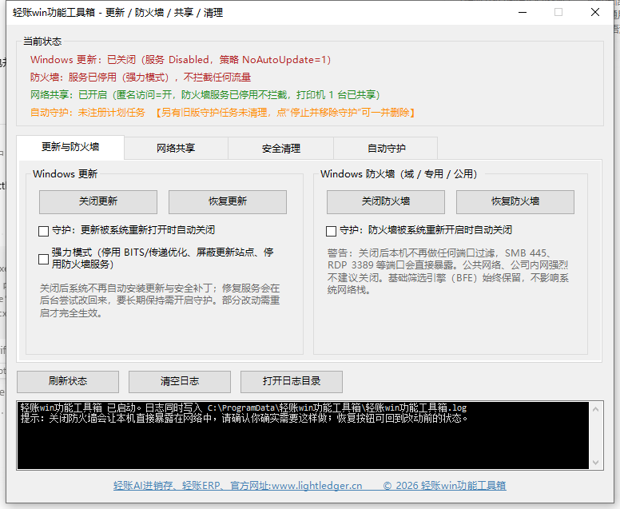

# 轻账win功能工具箱

Windows 7 / 10 / 11 的实用 tweaks 合集：自动关闭 / 恢复 **系统更新** 和 **防火墙**，一键开启 **局域网共享（打印机 / 文件夹，Everyone 权限）**，**一键安全清理**（临时文件 / 微信 / QQ 缓存 / 休眠），并可开启后台守护，让被系统改回去的设置自动恢复。以后会持续往工具箱里加功能。

免安装、无第三方依赖，只用系统自带的 PowerShell 5.1 + WinForms。同一个 EXE 自适应系统版本：Windows 8 及以上走 PowerShell 原生模块，Windows 7 走 netsh / WMI / 计划任务 COM / 注册表等旧版接口。

> 本工具旧名「轻账优化大师」，自 v1.2 起改为「轻账win功能工具箱」。首次启动会自动把旧名的配置、恢复快照和守护计划任务迁移到新名称与新数据目录，不需要手动处理；卸载时会一并清理旧名遗留。
>
> 内部文件名与函数仍沿用 WinGuard 代号（`WinGuard.ps1`、`Get-WinGuardStatus` 等），仅为实现细节，不影响使用。



目录：[下载](#下载) · [风险提示](#-先读这一段) · [文件说明](#文件) · [使用](#使用) · [具体改了什么](#具体改了什么) · [Windows 7 兼容](#windows-7-兼容说明) · [守护原理](#守护是怎么工作的) · [排查](#排查) · [自检](#自检) · [加新功能页](#往工具箱里加一个新功能页) · [更新日志](CHANGELOG.md)

## 下载

| 版本 | 文件 | 大小 | SHA256 |
| --- | --- | --- | --- |
| v1.2.2（最新） | [`轻账win功能工具箱.exe`](https://github.com/xyz007wjm/ll-tools/blob/main/%E8%BD%BB%E8%B4%A6win%E5%8A%9F%E8%83%BD%E5%B7%A5%E5%85%B7%E7%AE%B1.exe) | 147 KB | `99B695885A715F0B4CF1051AAF9BB06942AEDFC6AF5B819FBB72F3CD82BF992C` |
| v1.2.2 | `轻账win功能工具箱_v1.2.2.zip`（内含同一个 EXE） | 32 KB | `3BD6507086BDDD45D7ECFE31190C4155EE5DC393FCA341CF62505F67BFEA8A74` |

下载方式三选一：

1. **仓库文件页**（推荐）：点开 `轻账win功能工具箱.exe` → 右上角 **Download raw file**（或 ⋯ → Raw）。
2. **git clone** 本仓库，直接用仓库里的 EXE 或压缩包。
3. 克隆后自己跑 `build\build.ps1` 重新打包（需要系统自带的 .NET Framework 4.x csc.exe）。

校验（PowerShell）：

```powershell
Get-FileHash -Algorithm SHA256 .\轻账win功能工具箱.exe
```

> 国内网络直连 `raw.githubusercontent.com` 常被重置，命令行 `curl` 拉不下来时改用浏览器打开仓库文件页点 **Download raw file**。
> EXE 未做代码签名，首次运行会弹 SmartScreen：**更多信息 → 仍要运行**。

## ⚠️ 先读这一段

- **关闭防火墙后，本机对局域网和互联网不再有任何端口过滤**，共享服务（SMB 445、RDP 3389、打印机等）会直接暴露。公共网络（咖啡馆、公司内网）下强烈不建议关闭。
- **开启 Everyone 共享意味着局域网内任何设备都能读写共享文件夹、使用打印机**，还会打开匿名访问 / 空密码兼容、允许 Guest 认证、把当前网络设为“专用”。不要在公司、学校等不受信任的网络上开启。
- **关闭 Windows 更新意味着安全补丁也不会安装**，长期关闭会累积风险。Windows Update 修复服务（WaaSMedicSvc）会在后台尝试把设置改回来，所以才有“守护”功能。
- 所有改动前都会把服务的原始启动类型和注册表策略原值记录到 `%ProgramData%\轻账win功能工具箱\snapshot.json`，恢复时按快照回滚。**没有快照时会退回系统默认值**，因此第一次使用请先点“关闭”，再点“恢复”验证一遍回滚链路。
- 部分改动（尤其 `WaaSMedicSvc`、已运行进程的生效状态）需要**重启**才完全生效。
- 建议先在虚拟机或测试机上验证，再用于主力机器。

## 文件

| 文件 | 作用 |
| --- | --- |
| `轻账win功能工具箱.exe` | **单文件打包版**：双击即用，脚本内嵌在 EXE 里，首次运行自动解压到 `%ProgramData%\轻账win功能工具箱\app\` |
| `start-gui.bat` | 双击打开图形界面，未提权会弹 UAC 请求管理员权限 |
| `WinGuard.ps1` | 图形界面本体（横向选项卡布局） |
| `core.ps1` | 全部逻辑：开关 / 恢复 / 状态查询 / 快照 / 清理 / 守护计划任务 / 旧名迁移 |
| `watchdog.ps1` | 由计划任务以 SYSTEM 身份静默调用的守护脚本 |
| `cli.ps1` | 命令行入口，便于写进部署脚本 |
| `selfcheck.ps1` | 36 项自检（WinForms 类型与选项卡布局、配置读写、快照往返、清理安全性、共享状态解析、计划任务对象、Win7 兼容路径、旧名迁移、引号安全等） |
| `restore-all.bat` | 一键恢复更新、防火墙与网络共享到改动前状态 |
| `uninstall.bat` | 恢复设置 + 删除守护计划任务 + 删除新旧两个数据目录 |
| `build\` | 打包用：`Launcher.cs`（内嵌脚本的 EXE 壳，内含 `Version` 常量）+ `build.ps1`（生成 `app.ico` 并编译） |
| `docs\screenshot.png` | 界面截图，README 顶部引用 |
| `CHANGELOG.md` | 版本变更历史 |
| `LICENSE` | 许可与免责说明（当前为「保留所有权利」） |
| `旧版本\` | 改名前的 `轻账优化大师.exe`、v1.1.1 压缩包与旧界面脚本，仅作存档，勿再分发 |

## 使用

### 打包版（推荐）

```
双击 轻账win功能工具箱.exe
```

- 首次运行会把脚本解压到 `%ProgramData%\轻账win功能工具箱\app\`（守护计划任务、日志也都指向这个稳定位置，之后移动/删除 EXE 都不影响已注册的守护）。
- 未提权时会弹出 UAC；提权后打开图形界面，与脚本版完全一致。
- 因为 EXE 没有数字签名，Windows 可能显示 SmartScreen 提示：点 **更多信息 → 仍要运行**。
- 重新打包：修改脚本后运行 `build\build.ps1`，并递增 `build\Launcher.cs` 里的 `Version` 常量。

### 图形界面

```
双击 start-gui.bat
```

界面是横向布局：**顶部一条当前状态 + 中间四个选项卡 + 底部日志**，以后加功能就加新选项卡。

- **当前状态**（顶部常驻）：更新服务启动类型与策略、三个防火墙配置文件开关、网络共享是否开启、守护任务是否注册。
- **选项卡 1「更新与防火墙」**：左栏 `关闭更新` / `恢复更新` + 更新守护勾选 + 强力模式勾选；右栏 `关闭防火墙` / `恢复防火墙` + 防火墙守护勾选，两栏并排，各带一段说明。
- **选项卡 2「网络共享」**：左栏 `一键开启文件/打印机共享` / `恢复共享设置` + 共享守护勾选；右栏选文件夹、填共享名、`共享给 Everyone`、`共享所有打印机`。
- **选项卡 3「安全清理」**：勾选要清理的类别（临时文件与系统缓存 / 微信缓存 / QQ 缓存），点 `开始清理`；只删除超过 24 小时未改动的缓存文件，被占用的文件自动跳过，聊天记录与接收文件一律不碰。“关闭休眠”默认不勾选，勾选后会用 `powercfg /h off` 关闭休眠并删除 hiberfil.sys（快速启动随之失效，可随时用命令行 `hibernate-on` 恢复）。
- **选项卡 4「自动守护」**：设置检查间隔（5–240 分钟），`保存并启动守护` 注册 SYSTEM 计划任务 `轻账win功能工具箱守护`；`停止并移除守护` 注销它。守护覆盖更新、防火墙、网络共享三项，按勾选内容决定。

底部 **强力模式** 会额外做这些事，风险也更大：

- 停用并禁用 `BITS`、`DoSvc`（会影响微软商店、传递优化、其他下载任务）
- 写入 `DoNotConnectToWindowsUpdateInternetLocations`，禁止本机访问更新站点
- 写入防火墙组策略 `EnableFirewall=0`，此时 **Windows 安全中心界面里的开关会变灰**，只能靠轻账win功能工具箱或删策略恢复
- 停用并禁用 `mpssvc` 服务本身

### 命令行

```powershell
# 必须在管理员 PowerShell 里执行写操作
powershell -NoProfile -ExecutionPolicy Bypass -File cli.ps1 -Action status
powershell -NoProfile -ExecutionPolicy Bypass -File cli.ps1 -Action disable-all
powershell -NoProfile -ExecutionPolicy Bypass -File cli.ps1 -Action disable-all -Deep
powershell -NoProfile -ExecutionPolicy Bypass -File cli.ps1 -Action watch-on -IntervalMinutes 15 -Deep
powershell -NoProfile -ExecutionPolicy Bypass -File cli.ps1 -Action restore-all
powershell -NoProfile -ExecutionPolicy Bypass -File cli.ps1 -Action share-on
powershell -NoProfile -ExecutionPolicy Bypass -File cli.ps1 -Action share-folder -Path "D:\共享资料" -ShareName ziliao
powershell -NoProfile -ExecutionPolicy Bypass -File cli.ps1 -Action printers-share
powershell -NoProfile -ExecutionPolicy Bypass -File cli.ps1 -Action share-off
powershell -NoProfile -ExecutionPolicy Bypass -File cli.ps1 -Action clean
powershell -NoProfile -ExecutionPolicy Bypass -File cli.ps1 -Action hibernate-off
powershell -NoProfile -ExecutionPolicy Bypass -File cli.ps1 -Action hibernate-on
powershell -NoProfile -ExecutionPolicy Bypass -File cli.ps1 -Action uninstall
```

`-Action` 取值：`status`、`disable-update`、`restore-update`、`disable-firewall`、`restore-firewall`、`disable-all`、`restore-all`、`watch-on`、`watch-off`、`share-on`、`share-off`、`share-folder`（需 `-Path` 与 `-ShareName`）、`printers-share`、`clean`、`hibernate-off`、`hibernate-on`、`uninstall`。

## 具体改了什么

**Windows 更新**

- 组策略：`HKLM\SOFTWARE\Policies\Microsoft\Windows\WindowsUpdate` 及 `\AU` 下写入 `NoAutoUpdate=1`、`AUOptions=1`、`ScheduledInstallDay=0`、`ScheduledInstallTime=3`、`UseWUServer=0`
- 服务：停止并禁用 `wuauserv`、`UsoSvc`、`WaaSMedicSvc`（强力模式再加 `BITS`、`DoSvc`）
- 计划任务：禁用 `\Microsoft\Windows\WindowsUpdate\` 与 `\Microsoft\Windows\UpdateOrchestrator\` 任务
- 恢复：按快照还原启动类型、按快照还原策略原值、重新启用计划任务

**防火墙**

- `netsh advfirewall set allprofiles state off` + `Set-NetFirewallProfile -All -Enabled False`
- 强力模式再加组策略与 `mpssvc` 服务停用
- `BFE`（基础筛选引擎）始终不动：停掉它会破坏系统网络栈，收益为负

**网络共享（Everyone）**

- 注册表：`Lsa\everyoneincludesanonymous=1`、`Lsa\restrictanonymous=0`、`Lsa\LimitBlankPasswordUse=0`、`LanmanServer\Parameters\RestrictNullSessAccess=0`、`LanmanWorkstation\Parameters\AllowInsecureGuestAuth=1`（允许匿名 / 空密码 / Guest 认证）
- 防火墙：启用“文件和打印机共享”“网络发现”两个显示组下的所有规则（按快照记录每条规则的原始状态）
- 服务：`FDResPub`、`SSDPSRV`、`upnphost`、`fdPHost`、`LanmanServer`、`LanmanWorkstation`、`Spooler` 全部设为自动并启动（原始启动类型记录在快照里）
- 网络：`Set-NetConnectionProfile -NetworkCategory Private`，把当前网络设为“专用”（原始类别记录在快照里）
- 打印机：所有未共享的打印机 `Set-Printer -Shared $true`
- 文件夹：`New-SmbShare -FullAccess Everyone`，若文件夹原本没有 Everyone NTFS 权限，再用 `icacls /grant "*S-1-1-0:(OI)(CI)F"` 授予完全控制（SID 写法不受系统语言影响）；是否加了权限、加了哪些共享都记在快照里，恢复时逐个删除
- 刻意**不**启用 SMB1（已淘汰且不安全）
- 恢复：按快照逐项回滚——删策略值、还原防火墙规则与网络类别、取消共享新增的打印机与文件夹、还原服务启动类型

**一键安全清理**

- 临时文件与系统缓存：`%TEMP%`、`C:\Windows\Temp`、WER 报告队列/归档、`SoftwareDistribution\Download`、传递优化缓存
- 微信缓存：经典版各账号 `WeChat Files\<账号>\FileStorage\{Cache,Temp}`、4.0 版 `xwechat_files\...\{cache,temp}`、崩溃日志目录
- QQ 缓存：各账号 `Tencent Files\<账号>\{Image,Video,nt_qq\nt_data\Pic,nt_qq\nt_data\Video}`、`Tencent\QQ\STemp`、`Tencent\Tencentdl`
- 安全规则：只删除超过 24 小时未改动的文件；单个文件删除失败（被占用等）自动跳过；不跟随符号链接；**绝不碰聊天记录数据库与接收文件（FileRecv / MobileFile 等）**
- 休眠（可选）：`powercfg /h off` 关闭休眠并删除 hiberfil.sys（快速启动同时失效）；`hibernate-on` 恢复

## Windows 7 兼容说明

同一个 EXE 在 Windows 7 上自动切换为旧版接口，功能与 Windows 10/11 一致：

| 能力 | Windows 8+ | Windows 7 |
| --- | --- | --- |
| 更新计划任务 | `ScheduledTasks` 模块 | 任务计划 COM（Schedule.Service）+ `schtasks.exe /change` |
| 防火墙规则 | `NetSecurity` 模块 | `HNetCfg.FwPolicy2` COM + `netsh advfirewall set rule`；服务停用时退回注册表 `FirewallRules` 解析 |
| 防火墙配置文件 | `Get-NetFirewallProfile` | 注册表 `SharedAccess\Parameters\FirewallPolicy`（专用配置文件在 Win7 是 `StandardProfile`） |
| 共享创建 / 删除 | `SmbShare` 模块 | WMI `Win32_Share`（Everyone 完全控制用 `Win32_SecurityDescriptor`） |
| 打印机共享 | `PrintManagement` 模块 | `Win32_Printer`（读取）+ `System.Printing`（写入） |
| 守护计划任务 | `Register-ScheduledTask` | `schtasks /create /ru SYSTEM` |

**前置条件**：Windows 7 需为 **SP1**，并安装 **.NET Framework 4.5.2+** 与 **WMF 5.1（PowerShell 5.1）**；全部脚本都带 `#requires -Version 5.1` 声明，版本过低会直接报错提示。

**已知差异**：

- Win7 没有“网络配置文件类别（专用/公用）”接口，开启共享时跳过“设为专用网络”这一步（日志会注明）。
- Win7 上防火墙服务停用（强力模式）时规则枚举依赖 `FwNotFiltering` 判定，行为与 Win10 一致。
- 防火墙规则名称在中文系统上为本地化文本，切换规则用 `netsh set rule name=...`，已按 COM 返回的真实名称处理。

> 开发机上已用“强制 Win7 模式”跑通全部旧版代码路径（WMI 共享创建/删除、schtasks 注册/删除、计划任务 COM 读取、注册表规则解析、System.Printing 打印机读取）。最终上线前仍建议在一台真实 Windows 7 机器上跑一遍 `selfcheck.ps1` 并点一遍“关闭/恢复”。

## 守护是怎么工作的

`watchdog.ps1` 每 N 分钟由 SYSTEM 计划任务拉起一次，读取 `config.json`：

```powershell
# 干跑，只打印期望/实际状态，不改系统
powershell -NoProfile -ExecutionPolicy Bypass -File watchdog.ps1 -DryRun
```

若配置要求关闭（或要求共享开启）而实际已被系统改回，就重新执行。日志见 `%ProgramData%\轻账win功能工具箱\轻账win功能工具箱.log`。

## 排查

- **“需要管理员权限”**：UAC 被拒或非管理员 PowerShell。写操作必须提权，只读 `status` 不受影响。
- **某一步显示“未生效”**：`WaaSMedicSvc` 等受 TrustedInstaller 保护的服务，管理员也会拿到 Access Denied，脚本会记录并继续；这类项需要重启或改属主，不影响其它项生效。
- **强力模式关闭防火墙后，状态栏显示“防火墙：服务已停用（强力模式）”**：这是正常现象——`mpssvc` 停用后防火墙不再过滤任何流量，规则列表也读不到；此时网络共享仍会显示“已开启（防火墙服务已停用不拦截）”。
- **界面乱码**：`.ps1` 必须是带 BOM 的 UTF-8（PowerShell 5.1 对无 BOM 文件按 GBK 解析）；`.bat` 第一行后的 `chcp 65001` 负责控制台代码页。
- **改完没生效**：重启一次，或先 `停止并移除守护`，再点 `恢复`，确认状态栏读数变化。
- **想彻底回到初始状态**：`uninstall.bat`。

## 自检

```powershell
powershell -NoProfile -ExecutionPolicy Bypass -File selfcheck.ps1
```

覆盖 GUI 用到的 WinForms 类型与枚举、配置持久化往返、状态对象字段（含共享）、策略快照写入与还原（在 `HKCU` 临时键上跑，不碰系统策略）、无快照时的默认清理分支、共享状态解析、防火墙规则关键词筛选、icacls 的 Everyone ACE 识别、共享分区快照往返、计划任务对象构造，6 项 Win7 兼容路径（注册表规则解析、配置文件读取、计划任务 COM、schtasks 往返、Win32_Printer/System.Printing、WMI 共享往返），清理安全性（24 小时过滤 + 跳过被占用文件）、旧名迁移的搬移与幂等，以及一条引号安全静态检查。全部通过才建议实机使用。

## 往工具箱里加一个新功能页

界面已经改成选项卡式，加功能就是加一页，改动集中在三个文件：

1. **`core.ps1`**：写功能函数，遵循现有约定
   - 用 `Invoke-Step '步骤说明' { ... } -Sink $Sink` 包每一步，日志和错误格式才能统一
   - 改动系统前先用 `Add-Snapshot*` 记录原值，恢复函数按快照回滚
   - Win7 差异用 `if ($script:IsLegacyOS) { 旧接口 } else { cmdlet }` 分岔
   - 需要提权的入口先调 `Require-Admin`
2. **`WinGuard.ps1`**：新建一个 `TabPage`，塞进 `$tabs.TabPages.AddRange(@(...))`，控件用文件顶部的工厂函数 `New-ToolGroup` / `New-ToolButton` / `New-ToolCheck` / `New-ToolLabel` 摆放；状态栏要显示新功能的读数，就同步改 `Get-WinGuardStatus` 的字段和 `$refresh` 里的赋值
3. **`selfcheck.ps1`**：给新逻辑补 `Check '标签' { ... }` 断言（尽量在临时目录 / `HKCU` 临时键上跑，不碰真实系统状态）

然后：

```powershell
powershell -NoProfile -ExecutionPolicy Bypass -File selfcheck.ps1   # 必须全绿
# 递增 build\Launcher.cs 里的 Version 常量（不改版本号，已解压的旧脚本不会刷新）
powershell -NoProfile -ExecutionPolicy Bypass -File build\build.ps1
```

**两个踩过的坑**：

- `.ps1` 必须存成**带 BOM 的 UTF-8**，否则 PowerShell 5.1 按 GBK 解析，中文直接变乱码。
- **双引号字符串里不要出现中文全角引号 `“ ”`**：PowerShell 把它们当作字符串定界符，会把一行拆成多个参数，报错信息还常常指向别处（本项目就因此让 GUI 启动即崩）。要引用界面按钮名，用单引号串 + `「」`。

## 许可

见 [LICENSE](LICENSE)。当前为**保留所有权利**：可免费下载、在自己管理的机器上使用；未经许可不得再分发、转售或去掉「轻账」品牌信息。工具会改动更新、防火墙与共享等系统级安全设置，风险自负，改动前都有快照可回滚。
